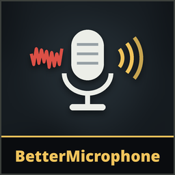

# BetterMicrophone

**Version 1.0.0**

**A cleaner, steadier voice** for everyone who hears you: fans, keyboards, hum, room noise and rumble removed, silence between your words, even volume, no clipping when you shout, and a higher voice quality. The mimics copy the cleaner voice too.

**Only you need it**: it changes what you send. Each player who wants to sound better installs it.

## What it does
The game's voice chat (Dissonance) cleans your microphone with WebRTC's noise suppression. It also ships **RNNoise**, a neural network noise remover, but leaves it off. BetterMicrophone turns it on and wraps it in a voice chain of its own:

1. **Mic boost** (optional).
2. **RNNoise**, then the game's own **WebRTC** noise suppression, kept at the game's level (VeryHigh). Measured in game on steady noise: RNNoise takes 25-50 dB off fan, pink and white noise at ordinary levels, WebRTC another 13-20 dB, and WebRTC also catches the quiet hiss that RNNoise lets through. RNNoise gets your microphone's full sound: filtering the low end away before it made it stop working.
3. A **low cut** (removes rumble, desk knocks, breath pops) and an optional **hum filter** (50 or 60 Hz electrical hum and its harmonics).
4. **Silence between words**: what's left of the noise is lowered while you don't speak. Whether you speak is judged on your microphone's input against its own noise floor, and on the game's voice detection (Silero), not on the cleaned sound, whose faint leftovers flicker like speech. It holds open through word ends and short pauses.
5. **Even volume**: a quiet or loud mic is brought to a steady level while you speak. It only learns from your speech and never lifts the noise between words.
6. **Limiter**: shouting never clips (-1 dBFS ceiling).
7. **Send quality**: your voice is sent at 24 kbps (or 32 kbps with *Very high*). The game ships its voice chat set to Low, 10 kbps.

It runs on the game's voice thread at about 0.03 ms per 10 ms of audio (measured in game).

## Options
**Patches > BetterMicrophone** on the main menu:
- **Better microphone**: on/off (default on). Off: your voice is exactly as the game makes it.
- **Noise removal**: Light / Medium / **Strong** / Max, how deep RNNoise goes (WebRTC stays at the game's level; one notch lower with Light). Strong suits most rooms; Max for loud fans or mechanical keyboards (it can dull a quiet voice).
- **Silence between words**: Off / Light / **Normal** / Strong (how far the noise between words goes down: 12 / 24 / 40 dB).
- **Low cut**: Off / 60 / **90** / 120 Hz.
- **Hum filter**: **Off** / 50 Hz / 60 Hz (50 Hz in Europe, Asia, Africa and most of South America; 60 Hz in North America, Brazil and western Japan).
- **Even out volume**: **on** / off.
- **Voice clarity**: on / **off**, a light presence boost.
- **Mic boost**: -12 to +24 dB (default 0), before everything else.
- **Send quality**: Game's own (Low, 10 kbps) / **High (24 kbps)** / Very high (32 kbps). Takes effect from your next game.

### Test your microphone
**Record 5 s**, then **Play original** and **Play cleaned** to hear the difference. On the main menu it records your game microphone and cleans it exactly as in a game (the game's own RNNoise and WebRTC included); in a lobby or game it records your live voice, before and after. The live meter shows your level in and out, whether it hears you speaking, the auto gain and the noise floor.

## Install
Use the [installer](../Installer/) (Windows) or `python3 linux/mimesis-patches.py install BetterMicrophone` on Linux (see the [Linux tool](../linux/)).

## Good to know
- Background noise that the game used to send as "voice" is mostly gone, so it also stops making you sound like you're talking (the game's voice meter, and what monsters that hear voices react to).
- The game's own voice settings aren't saved over: turning the patch off or removing it gives you the game's voice back as it was.

## Uninstall
Use the installer's **Uninstall selected**, or delete `BetterMicrophoneRuntime.dll` from the game's `Mods` folder.

## AI disclosure
This mod was made with the help of an AI coding assistant (Claude, by Anthropic): code, documentation and icons.
