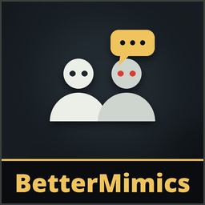

# BetterMimics

**Version 1.0.0**

**Mimics that act like the people they copy.** The game's mimics gave themselves away: one mimic could speak with three different people's voices in a minute, it talked over you, answered a split second after you stopped, stared at nothing, and flip-flopped between walking and running every few seconds. This patch keeps the game's own mimic brain (its behavior trees and its learned movement model) and fixes what it does around them.

**Only the host needs it.** Everyone in the host's game sees and hears the difference, modded or not. Mimics stay exactly as dangerous: nothing about their attacks changes.

## What changes
### Voice
- **One voice per mimic.** Each mimic keeps one person's voice for the whole level: the player its persona copies, or else the player farthest from it when it first speaks (the one least likely to be standing next to it). When it later approaches players and the game picks a persona for it (whose habits it copies), that's the same person. The game mixed everyone's recordings. If that person leaves the game, the mimic picks another voice.
- **Quiet next to the real one.** A mimic doesn't speak while the person it sounds like is near it: two of the same voice in one place is a dead giveaway.
- **Turn-taking.** It doesn't start talking on its own while someone near it is talking (answering you is the game's own moment: when you finish a line).
- **Answers that sound like answers.** Lines people said right after someone else spoke are remembered as replies. A mimic answering you prefers those (and short lines); a mimic speaking first prefers the rest. If nothing fits the situation, the game's own pick runs unchanged.
- **A human pause** (0.55-1.2 s) before it answers you, instead of the game's 0.2 s.

### Body
- **Natural gaze.** A standing mimic looks at whoever talks, looks back at whoever stares at it, looks at the nearest player, glances away now and then, and looks around when nobody's there. Its head tilts up and down too (the same view-direction message a player's game sends), and goes back to a walking pose when it walks. Up close, where the game's own movement model (trained on real players) steers it, the model does the looking.
- **Picks up scrap.** A wandering mimic that spots scrap, also on its way somewhere, walks over, looks down, picks it up and carries it, and puts it down a minute or two later. **Never from the tram.** It drops it if you kill it, or when it takes up a weapon to fight: you lose nothing.
- **Dances and emotes.** It joins a player's dance or emote nearby, and now and then emotes on its own near players.
- **Walks like a player.** It walks around instead of switching to a run every few seconds. It still runs to chase you and on long trips.
- Whatever it's doing (going for scrap, a dance), it stops at once when it's hurt or a player walks right up to it, and does nothing while it's stunned: it reacts as the game's mimic would.

## Install
Use the [installer](../Installer/) (Windows) or `python3 linux/mimesis-patches.py install BetterMimics` on Linux (see the [Linux tool](../linux/)). On by default; each part can be turned off in **Patches > BetterMimics**.

## How the game's mimics work
For the curious (reverse-engineered from EA 0.4.1):
- Each mimic runs a **behavior tree** on the host (`StreamingAssets/aidata/bt/npc_mimic_alpha_base_*.xml` and `npc_mimic_beta_base_*.xml`, the two kinds levels spawn): **passive** wanders between random points, **search** walks toward the nearest player, **checkfriendly** and **bewarefriendly** hand its body to a **neural movement model trained on real players** (Unity Sentis) and a decision agent that decides when to emote back, follow, drop scrap as bait, or attack; **combat**, **run** and others attack and flee.
- The game **learns each player as they play**: how often they talk, how long they look at a mimic before swinging at it. Mimics bound to a player's persona copy those numbers.
- **Voices**: every player's game records what they say together with the situation (players around, area, time of day, monsters and scrap nearby, events). The host picks a mimic's line by matching that situation and plays it from the mimic on every game.

BetterMimics adds to all of that; it never replaces the behavior trees or the model.

## Limits
- The voice changes need recordings: early in a game (fewer than three recorded lines per player) mimics speak as the game picks.
- Walkie-talkie, phone and transmitter voices stay the game's own.
- After a game update, each part turns off on its own if the game changed under it (the others keep working), and the Patches window lists what's still on.

## Uninstall
Use the installer's **Uninstall selected**, or delete `BetterMimicsRuntime.dll` from the game's `Mods` folder.

## AI disclosure
This mod was made with the help of an AI coding assistant (Claude, by Anthropic): code, documentation and icons.
