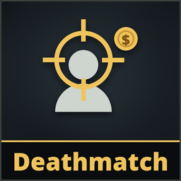

# Deathmatch

**Version 1.0.0**

**A deathmatch destination on the tram.** Now and then one of the tram's two destinations is a **deathmatch**, marked **DEATHMATCH** on the tram's screen. Take it or not, like any destination.

There:
- **Everyone arrives alone**, somewhere inside the building, far from each other and clear of monsters: you appear there as the level loads, not in the tram, and the mimics wait until everyone has arrived.
- **No monsters, only mimics.** Monsters and traps are kept out of the level from the start; mimics come as usual.
- **Everyone is lent the upgraded shotgun**: the double barrel, at full durability, with **both barrels loaded (2 shells)**. It goes back when the level ends, wherever it is (in a hand, on the floor, in the tram, on a hanger): a deathmatch doesn't hand out free guns. A double barrel you brought yourself stays yours.
- **Every death pays the team** gold (15 % of the stage's repair cost by default), whoever or whatever did it: once per player per level (a player back on their feet, after a revive or a quick reconnect, doesn't pay again).
- **The dead lose everything they carried.** Nothing drops where they die. **What's in the tram is safe**: stash what you want to keep before it starts.
- The level ends as usual (lever or time). The total is shown at the end.
- Someone joining in the middle of the level spectates, as in any level (the game itself does that): no shotgun, and no gold for that.

The rules stay in the corner of the screen during the deathmatch. [Poltergeist](../Poltergeist/)'s hauntings and [Hallucinations](../Hallucinations/)' fake attackers rest meanwhile: nothing to waste a shell on, no lights going out for one player only.

**Everyone needs it**: to see the mark on the tram's screen, the rules and the messages. The tram only offers a deathmatch when everyone in the game has the patch, in a version that can play with the host's (the host is told who doesn't). If someone without it joins the tram after that, the lever takes everyone to a normal level instead. The host's settings count. It needs **2 players** (with fewer, the tram doesn't offer it).

## Install
Use the [installer](../Installer/) (Windows) or `python3 linux/mimesis-patches.py install Deathmatch` on Linux (see the [Linux tool](../linux/)).

## Settings (host)
In **Patches > Deathmatch**:

| | |
|---|---|
| **Deathmatch destinations** | **Off**, **Rare** (15 % of the tram's rolls, default), **Often** (35 %), **Always** |
| **Gold per death** | **Small** (10 % of the stage's repair cost), **Normal** (15 %), **Big** (25 %) |
| **Fake players take part** | Testing with [FakePlayers](../FakePlayers/): fake players count as players and get a shotgun |

Works alongside [Traitor](../Traitor/): the two never mark the same destination.

## Uninstall
Use the installer's **Uninstall selected**, or delete `DeathmatchRuntime.dll` from the game's `Mods` folder.

## AI disclosure
This mod was made with the help of an AI coding assistant (Claude, by Anthropic): code, documentation and icons.
