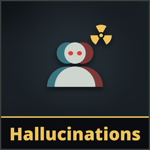

# Hallucinations

**Version 1.0.0**

Radiation gets into your head. **Above 50% radiation**, dead teammates can send you **hallucinations**: a mimic only you can see, which comes at you with a **shotgun**, a **bomb** or a **melee weapon** and **vanishes the moment its attack lands**. It does no damage at all, but you won't know that until it's gone. Shoot it or hit it and it vanishes too; your own weapons are real, so mind what else you hit.

Dead players keep possessing mimics as in the game, to speak through them. But **while they talk through a mimic, living players near it gain radiation** (1% per second within 10 m and on the same side, indoors or outdoors, never past 90%: talking never kills). The more they talk, the sooner you start seeing things.

**Everyone needs it**: the host checks the rules and passes the hallucinations on, the dead player sends them, the living player sees them. With a host that doesn't have it, nothing changes. A player who doesn't have it is never sent one (and talk radiation still reaches them, since only the host needs it for that).

## Install
There's no release yet, so the [installer](../Installer/) skips it. On Linux, `python3 linux/mimesis-patches.py install Hallucinations` builds and installs it (see the [Linux tool](../linux/)). On Windows, build it (`dotnet build -c Release` in `Hallucinations/Runtime`; the DLL ends up in `bin/Release/net472/`) or use the host's build, install [MelonLoader](https://github.com/LavaGang/MelonLoader/releases) (x64, 0.7.x) into the game folder, run the game once, then copy `HallucinationsRuntime.dll` into the game's `Mods` folder. See [Playing with friends](../README.md#playing-with-friends).

It replaces MimicControl, an earlier unreleased patch that let dead players drive the mimic they possess. If you installed a build of it, delete `MimicControlRuntime.dll` from the game's `Mods` folder (the Linux tool's `install` and `uninstall` do it for you).

## While dead
| | Keyboard / mouse | Controller |
|---|---|---|
| Send a hallucination to the player you watch (radiation above 50%) | **E** | **LT** |
| Possess a mimic near them (as in the game) | **E** | **LT** |

E does one or the other: when a mimic can be possessed, E possesses it, as in the game; otherwise, if the player you watch is above the threshold, E sends them a hallucination. The tip on your HUD says which: *Possess*, *Hallucinate*, or *Hallucinate (12)* while you wait for your cooldown. You can't see the hallucination you sent, but the tip tells you how it went. Keys follow your bindings in the game's settings.

The *Hallucinate* tip only shows once the player you watch is above the threshold (and has the patch): until then E does what it does in the game. With [SpectatorCam](../SpectatorCam/)'s free camera on, E flies the camera instead, so the tip is hidden: press F to go back to the normal camera first.

## Host options
**Patches > Hallucinations** on the main menu, used when you host:
- **Hallucinations**: on/off, hallucinations and talk radiation (default on)
- **Radiation above**: who can be sent hallucinations (default 50%)
- **Cooldown**: seconds a dead player waits after sending one (default 20 s)
- **Lifetime**: seconds before a hallucination whose attack never lands fades away (default 25 s)
- **Shotgun**, **Bomb**, **Melee weapons**: what they carry (all on by default; with all off they come bare-handed and grab, like a mimic)
- **Talking through a mimic**: radiation per second while the possessor talks (default 1%/s, 0 = off), range from the mimic (10 m, on the mimic's side: indoors or outdoors), and the radiation it never takes anyone past (90%)

Always: one hallucination at a time per player, only in levels (not in the tram).

## Testing alone
Turn on **Debug keys** (Patches > Hallucinations > Testing), host a game and enter a level:
- **Ctrl+Shift+H** sends a hallucination to yourself, whatever your radiation and with no cooldown. Each press uses the next weapon: shotgun, bomb, melee, bare hands.
- **Ctrl+Shift+J** adds 10% radiation to yourself (never past the talk limit).

In someone else's game the keys only work if the host has Debug keys on too.

## Limits
- The game's own radiation hallucinations are still there: from 55% radiation it shows its own fake mimics now and then. Those are the game's, not sent by anyone.
- A hallucination appears out of your sight and walks to you, so in a big open area it can take a while; if it can't find a way to you, it fades away and the dead player gets their cooldown back.
- A hallucination ignores doors closing after it appeared: it fades away instead of walking through.

## Uninstall
Delete `HallucinationsRuntime.dll` from the game's `Mods` folder, or use the installer's **Uninstall selected**. Installed with Gale or r2modman? Remove or disable it there instead.

## AI disclosure
This mod was made with the help of an AI coding assistant (Claude, by Anthropic): code, documentation and icons.
