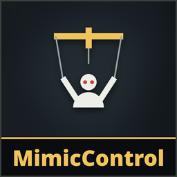

# MimicControl

**Version 1.0.0**

When you're dead and **possess a mimic**, you **control** it: walk, run and look around with it, and **grab living players**, until the mimic dies. No 12-second limit and no 40-second cooldown. The mimic's attack is the game's own strangle grab, so the victims see a normal mimic attack.

**The host and the player who takes the mimic need it.** Everyone else sees a normal mimic walking around and grabbing. With a host that doesn't have it, possession works as in the game (voice only, 12 seconds); a player who doesn't have it gets the normal possession too.

## Install
There's no release yet, so the [installer](../Installer/) skips it. On Linux, `python3 linux/mimesis-patches.py install MimicControl` builds and installs it (see the [Linux tool](../linux/)). On Windows, build it (`dotnet build -c Release` in `MimicControl/Runtime`; the DLL ends up in `bin/Release/net472/`) or use the host's build, install [MelonLoader](https://github.com/LavaGang/MelonLoader/releases) (x64, 0.7.x) into the game folder, run the game once, then copy `MimicControlRuntime.dll` into the game's `Mods` folder. See [Playing with friends](../README.md#playing-with-friends).

## Controls (while dead)
| | Keyboard / mouse | Controller |
|---|---|---|
| Take a mimic near the player you watch | **E** (as in the game) | **LT** |
| Move | W A S D | Left stick |
| Run | Shift | LB |
| Look | Mouse | Right stick |
| Grab | Left click | RB |
| Let go | E | LT |

The camera stays behind the mimic, like the game's possession camera; the mouse wheel zooms it. Keys follow your bindings in the game's settings.

## Host options

**Patches > MimicControl** on the main menu, used when you host:
- **Mimic control**: on/off (default on)
- **Attack cooldown**: seconds after a grab ends before the next one (default 2 s)
- **Attack strength**: how much contamination a grab adds, in % of a normal mimic's grab (default 50%)
- **One per death**: once their mimic dies or they let it go, a player can't take another until they die again (default on)
- **Delay after death**: seconds after dying before a player can take a mimic (default 0)
- **Block self-kills**: no mimic after dying from a fall, a pit, your own explosive, or contamination no monster or player caused (default off)

Always: control only works in levels (not in the tram), the mimic must be near a living player (about 10 m, checked by the host), and players who join mid-level don't get a mimic.

## Limits
- A mimic can't open doors or pick up items.
- Other spectators (with or without the patch) see the mimic's possession bar run out after 12 seconds; the possession goes on anyway.

## Uninstall
Delete `MimicControlRuntime.dll` from the game's `Mods` folder, or use the installer's **Uninstall selected**. Installed with Gale or r2modman? Remove or disable it there instead.

## AI disclosure
This mod was made with the help of an AI coding assistant (Claude, by Anthropic): code, documentation and icons.
